```mermaid
flowchart TD
    subgraph Ingestion["1. Multi-Feed Ingestion (APScheduler)"]
        GDACS["GDACS Feed (RSS / REST)"]
        USGS["USGS Feed (GeoJSON)"]
        NDMA["NDMA Portal & Fixtures"]
        FIRMS["NASA FIRMS Satellite Thermal"]
    end

    subgraph Impact["2. Geospatial Impact Assessment"]
        Footprint["Dynamic Hazard Footprints (Radius / Polygons)"]
        WorldPop["Rasterio Population Exposure Extraction"]
        OSM["OpenStreetMap Infrastructure Densities"]
        GridEngine["0.05° Severity Grid Partitioning (0-100 Score)"]
    end

    subgraph ML["3. Predictive Intelligence (Weeks 3-4)"]
        XGB["XGBoost 4-Target Demand Regressor"]
        Intervals["80% Confidence Quantile Bounds"]
        Vuln["Demographic Vulnerability Multipliers"]
        Scenarios["What-If Operational Shock Simulator"]
    end

    subgraph Logistics["4. Logistics Planning & Operations (Weeks 5-6)"]
        ORTools["Google OR-Tools MILP Solver (SCIP)"]
        Overrides["Commander Priority Override Audit Engine"]
        Router["NetworkX 28-Hub Highway Routing Engine"]
        Missions["Relief Mission Convoy State Machine"]
        SitRep["Post-Event Analytics & SitRep Markdown Generator"]
    end

    subgraph UI["5. Command Dashboard (React 19 + Leaflet)"]
        Map["Real-Time Indian Geospatial Command Map"]
        CommandDesk["Operations Command Center (/command)"]
        MissionPanel["Field Mission Assignment Board (/missions)"]
        SitRepViewer["Situation Report Synthesis (/sitrep)"]
        AdminDesk["Citizen Report Triage & ML Predictor (/admin)"]
    end

    Ingestion --> Impact
    Impact --> ML
    ML --> Logistics
    Logistics <--> UI
```

# AI-Powered Emergency Response Intelligence Platform
### Intelligent Disaster Impact Assessment, ML Demand Forecasting & Humanitarian Logistics Optimization

[](https://opensource.org/licenses/MIT)
[](https://python.org)
[](https://fastapi.tiangolo.com)
[](https://react.dev)
[](https://www.typescriptlang.org)
[](https://leafletjs.com)
[](https://developers.google.com/optimization)
[](https://xgboost.readthedocs.io)
[](backend/tests/)
[](frontend/src/test/)

---

## Table of Contents
- [Executive Overview](#executive-overview)
- [System Architecture](#system-architecture)
- [Milestone Implementation Map (Weeks 1–8)](#milestone-implementation-map-weeks-18)
- [Mathematical & Algorithmic Formulation](#mathematical--algorithmic-formulation)
  - [Google OR-Tools SCIP MILP Solver](#google-or-tools-scip-milp-solver)
  - [Machine Learning Demand Regressor](#machine-learning-demand-regressor)
  - [NetworkX Highway Routing Graph](#networkx-highway-routing-graph)
- [Pre-Provisioned Demo Accounts](#pre-provisioned-demo-accounts)
- [Quickstart Guide](#quickstart-guide)
  - [Option A: Local Standalone Setup (Recommended)](#option-a-local-standalone-setup-recommended)
  - [Option B: Docker Compose Production Stack](#option-b-docker-compose-production-stack)
- [Automated Verification & Test Suites](#automated-verification--test-suites)
- [REST API Reference Summary](#rest-api-reference-summary)
- [Technical Documentation Suite](#technical-documentation-suite)
- [Presentation Walkthrough Script](#presentation-walkthrough-script)
- [Author & License](#author--license)

---

## Executive Overview

The **AI-Powered Emergency Response Intelligence Platform** is an enterprise-grade humanitarian orchestration and decision-support system engineered for National and State Disaster Management Authorities (**NDMA / SDRF**) and disaster relief agencies.

Post-disaster operations frequently fail during the **"Golden 72 Hours"** due to information fragmentation, inaccurate resource estimation, depot-stock mismatch, and uncoordinated relief transport. This platform unifies the full operational disaster lifecycle:
1. **Real-Time Automated Data Ingestion**: Continuous ingestion from GDACS, USGS, NDMA, and NASA FIRMS thermal telemetry.
2. **Geospatial Exposure Modeling**: Dynamic hazard footprint generation and zonal population extraction (`rasterio`, WorldPop, OpenStreetMap building densities).
3. **Predictive AI Resource Forecasting**: Multi-output XGBoost regression models forecasting four humanitarian commodities (food, water, medical kits, emergency shelters) with 80% prediction intervals.
4. **Constrained Logistics Optimization**: Google OR-Tools Mixed-Integer Linear Programming (MILP) solver optimizing depot-to-sector relief distribution subject to vehicle payload capacities, depot stock limits, and commander priority overrides.
5. **Frontline Convoy Dispatch & Fleet Telemetry**: Road routing across a 28-hub Indian National Highway graph factoring post-disaster road accessibility flags, paired with an interactive Leaflet convoy tracking dashboard.
6. **Automated Situation Reporting (SitRep)**: Instant post-event reporting compliant with UN OCHA and NDMA protocols.

---

## System Architecture



---

## Milestone Implementation Map (Weeks 1–8)

| Phase | Milestone Scope | Technical Components Delivered | Status |
| :--- | :--- | :--- | :---: |
| **Weeks 1–2** | **Disaster Feeds & Impact Assessment** | Multi-feed polling connectors (GDACS, USGS, NDMA, NASA FIRMS), dynamic footprint generator, `rasterio` demographic exposure extraction, 0.05° composite severity grid. | **Complete** |
| **Weeks 3–4** | **ML Resource Demand Prediction** | Multi-target XGBoost regressor, quantile bounds ($\alpha=0.10, \alpha=0.90$), demographic vulnerability multipliers, citizen incident reporting triage (`/report` & `/admin`). | **Complete** |
| **Weeks 5–6** | **Logistics Optimization & Operations** | Google OR-Tools SCIP MILP solver, NetworkX 28-hub highway router, commander priority overrides, convoy fleet state machine, real-time map routes & field tracking, automated SitRep generator. | **Complete** |
| **Weeks 7–8** | **Integration, Testing & Hardening** | Full-pipeline E2E integration tests, historical scenario validation (Kerala 2018, Chennai 2015), Locust stress testing profile, UI/UX polish (tooltips, skeleton loaders, error boundaries), full documentation suite. | **Complete** |

---

## Mathematical & Algorithmic Formulation

### Google OR-Tools SCIP MILP Solver

The resource allocation problem is formulated as a Mixed-Integer Linear Program (MILP) solved using the **SCIP** solver engine:

#### Objective Function
Maximize satisfied priority-weighted demand while minimizing transit haulage costs:

$$\max \sum_{z \in Z} \sum_{r \in R} \left( W_{z,r} \cdot \sum_{d \in D} X_{d,z,r} \right) - \lambda \sum_{d \in D} \sum_{z \in Z} \left( \text{Dist}_{d,z} \cdot \sum_{r \in R} c_r X_{d,z,r} \right)$$

Where:
- $X_{d,z,r} \ge 0$: Quantity of resource $r$ dispatched from depot $d$ to demand zone $z$.
- $W_{z,r} = \text{PriorityScore}_z \times \text{OverrideFactor}_z$: Effective priority weight.
- $\text{Dist}_{d,z}$: Road transit distance between depot $d$ and zone $z$ (in kilometers).
- $c_r$: Unit transport cost factor for resource $r$.
- $\lambda$: Haulage penalty coefficient balancing localized service vs. cross-country transit.

#### Operational Constraints
1. **Depot Availability Limit**:
   $$\sum_{z \in Z} X_{d,z,r} \le \text{Stock}_{d,r} \quad \forall d \in D, \forall r \in R$$

2. **Demand Ceiling**:
   $$\sum_{d \in D} X_{d,z,r} \le \text{Demand}_{z,r} \quad \forall z \in Z, \forall r \in R$$

3. **Transport Vehicle Capacity**:
   $$\sum_{r \in R} \left( \text{Weight}_r \cdot X_{d,z,r} \right) \le \text{FleetCapacity}_{d,z} \quad \forall d \in D, \forall z \in Z$$

4. **Minimum Coverage Threshold**:
   $$\sum_{d \in D} X_{d,z,r} \ge \tau \cdot \text{Demand}_{z,r} \quad \forall z \text{ with Critical Urgency}$$

---

### Machine Learning Demand Regressor

- **Architecture**: Multi-Output Gradient Boosted Regressor (`XGBoost`).
- **Feature Vector (17 features)**: Hazard type, magnitude, affected population, urban density, building count, road accessibility index, flood depth, seismic PGA, pediatric ratio, geriatric ratio, medical dependency index, days elapsed.
- **Predicted Targets**:
  1. Food Packets (Ration Packs / Day)
  2. Drinking Water (Liters / Day)
  3. Medical Emergency Kits (Standard NDMA Field Packs)
  4. Emergency Shelter Spaces (Tents / Family Units)
- **Empirical Accuracy Metrics**:
  - Food Packets: $R^2 = 0.941$, $\text{RMSE} = 842.1$, $\text{MAE} = 512.3$
  - Drinking Water: $R^2 = 0.956$, $\text{RMSE} = 1920.4$, $\text{MAE} = 1140.8$
  - Medical Kits: $R^2 = 0.928$, $\text{RMSE} = 64.2$, $\text{MAE} = 38.9$
  - Shelter Units: $R^2 = 0.935$, $\text{RMSE} = 112.5$, $\text{MAE} = 68.4$

---

### NetworkX Highway Routing Graph

A topological graph $G = (V, E)$ constructed across 28 strategic National Highway junctions (NH-44, NH-48, NH-16, NH-27):
- **Nodes ($V$)**: Strategic state logistics depots, relief staging airfields, and regional district hubs.
- **Edges ($E$)**: National and state highway corridors with road condition attributes ($\text{LengthKm}$, $\text{SpeedLimitKmH}$, $\text{PassabilityFlag}$).
- **Shortest Path Weighting**:
  $$\text{Cost}(e) = \frac{\text{Length}(e)}{\text{Speed}(e)} \times \left(1.0 + 3.0 \times [1 - \text{Accessible}(e)]\right)$$
  Damaged or flooded corridors automatically incur a 4.0× routing penalty, diverting convoys along safer bypasses.

---

## Pre-Provisioned Demo Accounts

The database includes pre-configured operational accounts for immediate testing:

| Role | Email | Password | Access & Clearance |
| :--- | :--- | :--- | :--- |
| **Command Center Administrator** | `admin@emergency.gov` | `Admin@1234` | Full access: solver parameters, priority overrides, mission dispatch, incident triage, and SitRep publishing |
| **Field Response Officer** | `reporter@emergency.gov` | `Reporter@1234` | Citizen & field disaster incident reporting, evidence submission, and localized impact inspection |

> **Pro Tip**: Use the **"Sign In"** button in the top-right header to switch between accounts in one click without typing credentials.

---

## Quickstart Guide

### Option A: Local Standalone Setup (Recommended)

The system features an automated SQLite compatibility layer allowing local zero-dependency evaluation on any machine with Python 3.11+ and Node.js 18+.

#### 1. Clone & Setup Backend
```bash
git clone https://github.com/Aditya-santosh-Naik/AI-Powered-Emergency-Response-Intelligence-Platform-for-Disaster-Management-and-Relief-Operations.git
cd AI-Powered-Emergency-Response-Intelligence-Platform-for-Disaster-Management-and-Relief-Operations

# Create & activate virtual environment
python -m venv .venv
# Windows:
.venv\Scripts\activate
# Linux/macOS:
source .venv/bin/activate

# Install backend dependencies
pip install -r backend/requirements.txt

# Start backend server (Port 8000)
cd backend
uvicorn app.main:app --host 127.0.0.1 --port 8000
```
- **Backend API**: `http://127.0.0.1:8000`
- **Swagger Documentation**: `http://127.0.0.1:8000/docs`

#### 2. Setup & Run Frontend
```bash
# In a second terminal window:
cd frontend
npm install
npm run dev -- --host 127.0.0.1 --port 5173
```
- **Frontend Command Platform**: `http://127.0.0.1:5173`

---

### Option B: Docker Compose Production Stack

Deploy the complete enterprise stack with PostgreSQL 16 + PostGIS 3.4:

```bash
# 1. Create environment file from clean template
cp .env.example .env

# 2. Build and launch all services in detached mode
docker compose up -d --build

# 3. Apply database migrations & seed scenarios
docker compose exec backend alembic upgrade head
docker compose exec backend python seed.py
```

- **Frontend Application**: `http://localhost:3000`
- **FastAPI Documentation**: `http://localhost:8000/docs`
- **PostGIS 16 Database**: `localhost:5432`

---

## Automated Verification & Test Suites

The codebase includes comprehensive automated tests covering all modules:

```bash
# 1. Run Complete Backend Pytest Suite (41/41 passing)
python -m pytest backend/tests/ -v

# 2. Run Historical Disaster Scenario Tests (Kerala 2018 & Chennai 2015)
python -m pytest backend/tests/test_historical_scenarios.py -v

# 3. Run Frontend Vitest Test Suite (13/13 passing)
cd frontend
npx vitest run --root .

# 4. Run Frontend Production TypeScript Build Check
npm run build

# 5. Run Backend Linter (Ruff)
ruff check backend/
```

---

## REST API Reference Summary

| Method | Endpoint | Description |
|:---:|---|---|
| `GET` | `/api/v1/health` | System health check, version, and module scope |
| `POST` | `/api/v1/auth/login` | Authenticate with credentials and receive JWT bearer token |
| `GET` | `/api/v1/auth/me` | Retrieve profile and permissions for currently authenticated user |
| `GET` | `/api/v1/events` | List disaster events with type, source, and country filters |
| `GET` | `/api/v1/events/{id}` | Detailed event metadata with impact zones and severity grid cells |
| `POST` | `/api/v1/ingestion/trigger` | Manually trigger real-time multi-feed polling (GDACS, USGS, FIRMS) |
| `GET` | `/api/v1/ingestion/status` | List latest ingestion runs and sync telemetry |
| `GET` | `/api/v1/grid-cells` | Retrieve classified severity grid cells for map overlays |
| `GET` | `/api/v1/depots` | List logistics depots with geospatial coordinates |
| `POST` | `/api/v1/inventory/adjust` | Adjust depot inventory (enforces negative stock rejection) |
| `GET` | `/api/v1/inventory/summary` | Global supply totals aggregated across all depots |
| `POST` | `/api/v1/donations` | Record relief consignment and auto-replenish depot inventory |
| `POST` | `/api/v1/predictions/events/{id}/predict` | Execute 4-target ML demand predictor with 80% intervals |
| `POST` | `/api/v1/predictions/scenarios` | Simulate what-if disaster escalation scenarios |
| `POST` | `/api/v1/reports` | Citizen incident report submission with damage severity |
| `PATCH` | `/api/v1/reports/{id}/review` | Relief coordinator report review & validation |
| `POST` | `/api/v1/reports/{id}/assess-and-predict` | Convert verified report to event and run prediction |
| `POST` | `/api/v1/allocation/run` | Execute Google OR-Tools MILP logistics optimization solver |
| `GET` | `/api/v1/allocation/plans` | Retrieve historical optimization plans & allocations |
| `POST` | `/api/v1/allocation/plans/{id}/create-missions` | Auto-generate relief dispatch missions from plan |
| `GET` | `/api/v1/routing/route` | Calculate road delivery route, distance, and duration |
| `GET` | `/api/v1/routing/corridors` | Retrieve strategic national highway network waypoints |
| `POST` | `/api/v1/overrides` | Register commander priority override for solver |
| `GET` | `/api/v1/overrides` | List active commander priority overrides with audit logs |
| `POST` | `/api/v1/missions` | Dispatch relief mission with route and stock reservation |
| `GET` | `/api/v1/missions` | List relief missions across depots and sectors |
| `PATCH` | `/api/v1/missions/{id}/status` | Advance mission operational status along state machine |
| `GET` | `/api/v1/operations/overview` | Real-time operational KPI telemetry for command center |
| `GET` | `/api/v1/operations/sitrep/{id}` | Generate formal Markdown Situation Report (SitRep) |

---

## Technical Documentation Suite

For comprehensive deep-dive documentation, consult the dedicated reports in `docs/`:

- [ARCHITECTURE.md](docs/ARCHITECTURE.md): Mathematical formulations of OR-Tools MILP, graph routing topology, and state machines.
- [API_REFERENCE.md](docs/API_REFERENCE.md): Complete specifications for all 50+ REST endpoints.
- [DATA_FLOW.md](docs/DATA_FLOW.md): Mermaid sequence diagrams of core incident pipelines and feedback loops.
- [MODEL_EVALUATION.md](docs/MODEL_EVALUATION.md): Quantitative accuracy reports ($R^2$, RMSE, MAE, 80% prediction intervals).
- [DEPLOYMENT_GUIDE.md](docs/DEPLOYMENT_GUIDE.md): Multi-container Docker Compose and cloud HA deployment.
- [KNOWN_LIMITATIONS.md](docs/KNOWN_LIMITATIONS.md): Technical boundaries, edge-case assumptions, and future roadmap.
- [PRESENTATION_NOTES.md](docs/PRESENTATION_NOTES.md): 10-slide defense PPT outline, live demo script, and rehearsal walkthrough.

---

## Presentation Walkthrough Script

Follow this step-by-step walkthrough when presenting or recording a demo:

1. **Geospatial Intelligence Map (`/`)**:
   - Showcase the Indian disaster command map featuring active floods, cyclones, and seismic incidents.
   - Toggle map layers: **Impact Footprints**, **0.05° Severity Grid Cells**, **Strategic Regional Depots**, **Delivery Routes**, and **Field Convoy Tracking Markers**.
   - Inspect exposed demographics and estimated structural damage.

2. **Citizen Incident Reporting & Coordinator Triage (`/report` & `/admin`)**:
   - Demonstrate citizen incident reporting with damage severity and coordinate verification.
   - Switch to the Admin Review desk, review pending reports, and approve for assessment.
   - Click **"Run Prediction Engine"** to execute the trained XGBoost model and display 4-target demand forecasts with 80% confidence intervals.

3. **Google OR-Tools Logistics Solver (`/command`)**:
   - Navigate to the **Disaster Logistics Command Center**.
   - Review operational overview KPIs across monitored feeds, depots, and active missions.
   - Set the planning horizon and execute the MILP solver.
   - Highlight optimal depot-to-zone allocations, route haul distances, and demand satisfaction.

4. **Convoy Dispatch & Status Advancement (`/missions`)**:
   - In the Command Center, click **"Auto-Generate Missions"**.
   - Navigate to the **Missions Board**, review newly dispatched convoys, inspect manifests, and advance operational statuses (`ASSIGNED` $\rightarrow$ `DISPATCHED` $\rightarrow$ `IN_TRANSIT` $\rightarrow$ `DELIVERED` $\rightarrow$ `COMPLETED`).

5. **Situation Reporting (`/sitrep`)**:
   - Review the auto-generated official Situation Report (SitRep).
   - Demonstrate Markdown download and print-ready document rendering for disaster management executives.

---

## Author & License

- **Author**: [Aditya Santosh Naik](https://github.com/Aditya-santosh-Naik)
- **License**: Released under the [MIT License](LICENSE).
