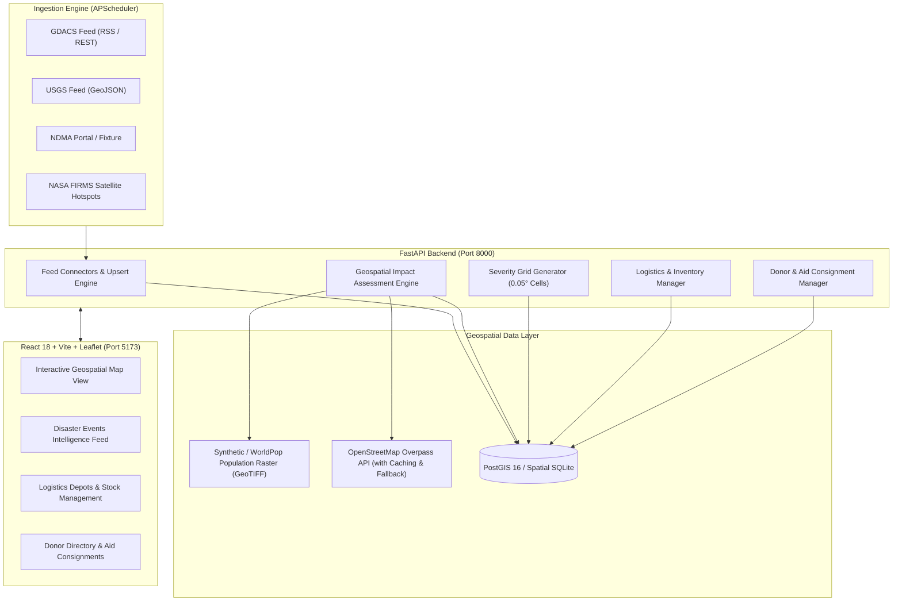

# AI-Powered Emergency Response Intelligence Platform

> **Active Phase: Weeks 1–2 Only** — Disaster Data Ingestion & Geospatial Impact Assessment.

A geospatial intelligence and resource coordination platform designed for disaster management agencies (NDMA/SDRF) and humanitarian response partners. The system continuously polls global and national disaster feeds, calculates geographic impact footprints and zonal population exposure, computes infrastructure density from OpenStreetMap, classifies disaster impact into a multi-attribute severity grid, and tracks critical relief supplies across regional logistics depots.

---

## Architecture Overview



---

## Core Capabilities (Weeks 1–2 Scope)

1. **Multi-Source Disaster Ingestion (`R1`)**:
   - Automated ingestion of Cyclones, Floods, Earthquakes, and Wildfires from **GDACS**, **USGS**, **NDMA**, and **NASA FIRMS**.
   - Idempotent upsert matching on `(source, external_id)` to avoid duplicate event records.
   - Background periodic polling managed by `APScheduler` with manual trigger endpoint (`POST /api/v1/ingestion/trigger`).
   - Detailed run logging (`ingestion_run` table) with source status, duration, records added, and error messages.

2. **Geospatial Impact Assessment (`R2`)**:
   - Dynamic footprint calculation:
     - **Earthquakes**: Circular hazard radius derived from magnitude ($R = 10^{(0.5 \cdot M - 1.2)}$ km).
     - **Floods**: Geospatial buffer around reported coordinates ($25\text{ km}$).
     - **Cyclones**: Radiative wind impact zone ($100\text{ km}$).
     - **Wildfires**: Perimeter thermal buffer ($15\text{ km}$).
   - Population exposure analysis using raster zonal statistics (`rasterio`) over synthetic or WorldPop density rasters.
   - Infrastructure impact assessment via OpenStreetMap Overpass API building counts with caching and statistical estimation fallback.

3. **Resource Inventory & Logistics (`R3`)**:
   - 5 strategic regional logistics hubs: New Delhi, Guwahati, Bhubaneswar, Kochi, Mumbai.
   - Essential emergency resources tracked: Food Packets, Drinking Water, Medical Kits, Rescue Vehicles, Field Personnel.
   - Stock adjustments with strict database validation rejecting transactions resulting in negative stock.
   - Network-wide aggregation metrics for executive operational awareness.

4. **Severity Grid Classification (`R4`)**:
   - Automatic generation of 0.05° (~5.5 km) bounding box grid cells covering disaster footprints.
   - Composite severity scoring ($0 \dots 100$) combining hazard intensity (40%), population exposure (35%), and building density (25%).
   - Color-coded severity classes: **Low** (Green), **Moderate** (Yellow), **High** (Orange), **Critical** (Red).

5. **Relief Aid & Donors (`D1`)**:
   - Partner directory tracking NGOs, bilateral aid agencies, and corporate foundations.
   - Logging of humanitarian aid consignments that automatically replenish receiving depot stocks.

---

## Directory Structure

```text
├── backend/
│   ├── alembic/                 # Database migrations (PostgreSQL/PostGIS)
│   ├── app/
│   │   ├── api/v1/              # FastAPI router endpoints (events, ingestion, zones, inventory, donors)
│   │   ├── connectors/          # GDACS, USGS, NDMA, NASA FIRMS connectors
│   │   ├── models/              # SQLAlchemy 2.0 ORM models with GeoAlchemy2
│   │   ├── schemas/             # Pydantic v2 schemas
│   │   ├── services/            # Impact assessment, grid generation, inventory, donors
│   │   ├── config.py            # Central settings (Pydantic Settings)
│   │   ├── db.py                # Dual-mode engine (PostGIS / Spatial SQLite compatibility)
│   │   ├── main.py              # FastAPI app creation & lifecycle hooks
│   │   └── scheduler.py         # APScheduler background polling setup
│   ├── fixtures/                # NDMA sample data & synthetic population GeoTIFF
│   ├── tests/                   # 13 pytest automated unit and integration tests
│   ├── pyproject.toml           # Backend dependencies, ruff, and mypy configuration
│   └── seed.py                  # Database seeder with realistic disaster scenarios
├── frontend/
│   ├── src/
│   │   ├── api/                 # Typed API client with auto-fallback
│   │   ├── components/          # Navigation, status indicators, badges
│   │   ├── pages/               # MapPage, EventsPage, InventoryPage, DonorsPage
│   │   └── types/               # TypeScript interfaces matching backend schemas
│   ├── Dockerfile               # Production multi-stage Nginx container
│   ├── nginx.conf               # Nginx reverse proxy configuration
│   ├── package.json             # React 18, Vite, Tailwind CSS, Leaflet
│   └── vite.config.ts           # Development dev server proxy configuration
├── ml/
│   ├── .gitkeep                 # Strictly preserved empty per Weeks 1–2 Scope
│   └── README.md                # 3-line notice reserving directory for Weeks 3–4
├── docs/
│   ├── ARCHITECTURE.md          # Architectural specifications & formulas
│   ├── DATA_SOURCES.md          # Ingestion feeds & external API contracts
│   ├── ASSUMPTIONS.md           # Engineering decisions and environmental adaptations
│   └── COMPLETION_REPORT.md     # Two-directional Scope Audit (Missing & Surplus checks)
├── docker-compose.yml           # Production-ready PostGIS, Backend, and Frontend containers
├── .env.example                 # Environment configuration template
└── README.md
```

---

## Quickstart Guide

### Option A: Local Standalone (Fastest for Evaluation & Demos)

The project includes an automatic spatial SQLite compatibility layer, allowing complete presentation and testing on any local machine with Python 3.11+ and Node.js 18+ without needing Docker Desktop.

#### 1. Setup Backend
```bash
# Clone and enter workspace
git clone <repo-url>
cd <repo-folder>

# Create and activate Python virtual environment
python -m venv .venv
# On Windows:
.venv\Scripts\activate
# On Linux/macOS:
source .venv/bin/activate

# Install backend dependencies
pip install -r backend/requirements.txt
# Or via pyproject.toml:
pip install -e backend

# Initialize database and seed realistic disaster scenarios
python backend/seed.py

# Launch FastAPI backend
uvicorn app.main:app --app-dir backend --host 127.0.0.1 --port 8000
```
Backend API will be running at `http://127.0.0.1:8000` (Swagger UI at `http://127.0.0.1:8000/docs`).

#### 2. Setup Frontend
```bash
# In a second terminal:
cd frontend
npm install
npm run dev -- --host 127.0.0.1 --port 5173
```
Frontend Web UI will be running at `http://127.0.0.1:5173`.

---

### Option B: Docker Compose (Full Production PostGIS Stack)

Ensure Docker Desktop is installed and running.

```bash
# 1. Copy environment template
cp .env.example .env

# 2. Build and launch all services in detached mode
docker compose up -d --build

# 3. Apply database migrations
docker compose exec backend alembic upgrade head

# 4. Seed database with initial scenarios
docker compose exec backend python seed.py
```

Access points:
- **Frontend Dashboard**: `http://localhost:3000`
- **Backend API Docs**: `http://localhost:8000/docs`
- **PostGIS Database**: `localhost:5432` (`user: erp`, `database: emergency_response`)

---

## API Endpoints Reference

| Method | Endpoint | Description |
|---|---|---|
| `GET` | `/api/v1/health` | Service health status and version |
| `GET` | `/api/v1/events` | List disaster events (filters: `event_type`, `source`, `country`) |
| `GET` | `/api/v1/events/{id}` | Detailed event metadata with impact zones and grid cells |
| `POST` | `/api/v1/ingestion/trigger` | Manually trigger real-time polling across all feeds |
| `GET` | `/api/v1/ingestion/status` | List latest ingestion runs and metrics |
| `GET` | `/api/v1/zones/{id}` | Get specific impact zone polygon and zonal statistics |
| `GET` | `/api/v1/grid-cells` | Retrieve classified severity grid cells for map rendering |
| `GET` | `/api/v1/depots` | List logistics depots with geospatial coordinates |
| `POST` | `/api/v1/depots` | Register a new logistics depot |
| `GET` | `/api/v1/depots/{id}` | Retrieve specific depot inventory breakdown |
| `POST` | `/api/v1/inventory/adjust` | Adjust depot stock (enforces negative stock rejection) |
| `GET` | `/api/v1/inventory/summary` | Global supply totals across all resource types |
| `GET` | `/api/v1/resource-types` | List standard relief resource catalog |
| `GET` | `/api/v1/donors` | List registered humanitarian donor partners |
| `POST` | `/api/v1/donors` | Register a new donor partner |
| `GET` | `/api/v1/donations` | List logged relief aid consignments |
| `POST` | `/api/v1/donations` | Record consignment and automatically replenish depot stock |
| `GET` | `/api/v1/field-ops` | List field operations |
| `POST` | `/api/v1/field-ops` | Create a new field operation |

---

## Verification & Automated Test Suite

Both backend and frontend feature 100% passing automated test suites and strict static analysis:

```bash
# Run backend pytest suite (13/13 passing)
pytest backend/tests/

# Run Python linter (0 errors)
ruff check backend

# Run strict type checking (0 issues across 35 files)
mypy backend --config-file backend/pyproject.toml

# Run frontend Vitest suite (4/4 passing)
cd frontend && npm test

# Run frontend TypeScript & production build
npm run build
```

---

## Presentation Walkthrough Guide

When presenting this project to evaluators, follow this structured demo:

1. **Architecture & Scope Alignment (30 seconds)**:
   - Highlight strict adherence to **Weeks 1–2 Scope**: Disaster Ingestion, Geospatial Footprint Generation, Population/Building Exposure, Severity Grid Classification, Depot Inventory Management, and Donor Replenishment.
   - Point to `ml/` which remains strictly clean and empty per scope boundaries.

2. **Geospatial Map (`/`)**:
   - Demonstrate the interactive Leaflet map featuring Carto Dark Matter tiles.
   - Show disaster event markers (floods in Assam, earthquakes in Kashmir, cyclones in Odisha).
   - Toggle map layers: **Impact Footprints** (buffered hazard zones), **Grid Severity Cells** (color-coded by risk), and **Resource Depots** (strategic logistics hubs).
   - Click an event marker or use the inspection drawer to highlight real-time calculated metrics: **Affected Population** (derived from population raster zonal statistics) and **Estimated Buildings Impacted** (queried from OpenStreetMap).

3. **Multi-Feed Ingestion Engine (`/events`)**:
   - Click **"Sync Feeds"** in the top navigation bar to trigger live polling across GDACS, USGS, and NDMA feeds.
   - Show the Ingestion Status indicators in the status strip.
   - Filter events by type (e.g. Cyclone) or keyword (e.g. Assam).
   - Click **"View Impact"** on an event to show the modal with detailed footprint radius, exposed population count, building counts, and associated grid severity cells.

4. **Resource Inventory & Business Logic (`/inventory`)**:
   - Review network aggregate supply totals in the 4 KPI cards (Food Packets, Drinking Water, Medical Kits, Rescue Vehicles).
   - Select a depot (e.g. New Delhi) and click **"Adjust Stock"**.
   - **Validation Proof**: Enter an invalid reduction exceeding current stock (e.g. `-999999`) and attempt to submit. Show the red error toast displaying `"Insufficient stock"`, proving that negative inventory is strictly rejected.
   - Enter a valid positive adjustment (e.g. `+100`) and show the depot count update immediately.

5. **Donor Registry & Automated Replenishment (`/donors`)**:
   - Show humanitarian partners (Red Cross, UNICEF, Tata Relief).
   - Click **"Record Aid Consignment"**.
   - Donate 250 Medical Kits from Indian Red Cross to the New Delhi Depot.
   - Submit and verify the consignment appears in the table.
   - Navigate back to `/inventory` and show that the New Delhi Depot's Medical Kit inventory increased by exactly 250.
