# AI-Powered Emergency Response Intelligence Platform

[](file:///d:/Infosys%20%20disaster/internship)
[](https://python.org)
[](https://fastapi.tiangolo.com)
[](https://react.dev)
[](https://leafletjs.com)
[](https://developers.google.com/optimization)
[](https://xgboost.readthedocs.io)

> **Complete Platform Scope: Weeks 1 through 8** — Ingestion, Geospatial Footprints, ML Demand Prediction, Linear Programming Optimization, Multi-State Routing, Mission Operations, and Post-Event Analytics.

A mission-critical geospatial AI and humanitarian logistics orchestration platform engineered for National and State Disaster Management Authorities (**NDMA / SDRF**) and humanitarian coordination partners. The platform unites continuous real-time multi-source data ingestion, demographic exposure modeling, multi-output machine learning resource forecasting, Google OR-Tools constrained logistics optimization, NetworkX-driven road routing, frontline convoy dispatching, and post-event situation reporting.

---

## Architecture Overview

```mermaid
flowchart TD
    subgraph Ingestion["1. Multi-Feed Ingestion (APScheduler)"]
        GDACS["GDACS Feed (RSS / REST)"]
        USGS["USGS Feed (GeoJSON)"]
        NDMA["NDMA Portal & Fixtures"]
        FIRMS["NASA FIRMS Satellite Thermal"]
    end

    subgraph Impact["2. Geospatial Impact Assessment"]
        Footprint["Dynamic Hazard Footprints (Radius / Polygons)"]
        WorldPop["Rasterio Population Exposure Extraction"]
        OSM["OpenStreetMap Infrastructure Densities"]
        GridEngine["0.05° Severity Grid Partitioning (0-100 Score)"]
    end

    subgraph ML["3. Predictive Intelligence (Weeks 3-4)"]
        XGB["XGBoost 4-Target Demand Regressor"]
        Intervals["80% Confidence Quantile Bounds"]
        Vuln["Demographic Vulnerability Multipliers"]
        Scenarios["What-If Operational Shock Simulator"]
    end

    subgraph Logistics["4. Logistics Planning & Operations (Weeks 5-6)"]
        ORTools["Google OR-Tools MILP Solver (SCIP)"]
        Overrides["Commander Priority Override Audit Engine"]
        Router["NetworkX 28-Hub Highway Routing Engine"]
        Missions["Relief Mission Convoy State Machine"]
        SitRep["Post-Event Analytics & SitRep Markdown Generator"]
    end

    subgraph UI["5. Command Dashboard (React 19 + Leaflet)"]
        Map["Real-Time Indian Geospatial Command Map"]
        CommandDesk["Operations Command Center (/command)"]
        MissionPanel["Field Mission Assignment Board (/missions)"]
        SitRepViewer["Situation Report Synthesis (/sitrep)"]
        AdminDesk["Citizen Report Triage & ML Predictor (/admin)"]
    end

    Ingestion --> Impact
    Impact --> ML
    ML --> Logistics
    Logistics <--> UI
```



---

## Core Capabilities Across Weeks 1–8

### 1. Disaster Data Ingestion & Impact Assessment (Weeks 1–2)
- **Continuous Multi-Feed Polling**: Automated polling of GDACS, USGS, NDMA, and NASA FIRMS feeds managed by `APScheduler` with manual trigger capabilities.
- **Geospatial Exposure Modeling**: Dynamic hazard footprints (magnitude-derived radii for earthquakes, circular/polygon buffers for floods, cyclones, and wildfires).
- **Zonal Population & Infrastructure Extraction**: High-performance demographic exposure calculations via raster zonal statistics (`rasterio`) and OpenStreetMap building counts.
- **0.05° Severity Grid**: Composite scoring combining hazard intensity (40%), population exposure (35%), and structural density (25%) into color-coded severity tiers.

### 2. Machine Learning Resource Demand Prediction (Weeks 3–4)
- **Multi-Output Gradient Boosting**: Trained XGBoost regressor predicting 4 critical humanitarian commodities: **Food Packets**, **Drinking Water (Liters)**, **Medical Emergency Kits**, and **Shelter Spaces**.
- **Quantile Uncertainty Bounds**: 80% prediction intervals ($\alpha = 0.10, \alpha = 0.90$) identifying conservative buffer requirements.
- **Vulnerability Profiling**: Isolates pediatric, geriatric, and medical dependency shares to scale relief without double-counting general population.
- **Live Scenario Simulator**: Allows emergency coordinators to model demand surges under severe road blockages or population displacements.

### 3. Logistics Optimization & Operations Command (Weeks 5–6)
- **Google OR-Tools Linear Programming Solver**: Formulates a Mixed-Integer Linear Programming (MILP) model allocating depot stocks across affected sectors, maximizing demand fulfillment while penalizing transit haulage.
- **Logistics Transit Routing**: NetworkX weighted graph modeling 28 Indian National Highway trunk hubs with Haversine distance, truck transit duration, and road accessibility degradation.
- **Commander Priority Overrides**: Authorizes emergency directors to manually elevate sector urgency scores with mandatory justifications and complete audit logging.
- **Relief Mission Management**: End-to-end convoy lifecycle state machine (`ASSIGNED` $\rightarrow$ `DISPATCHED` $\rightarrow$ `IN_TRANSIT` $\rightarrow$ `DELIVERED` $\rightarrow$ `COMPLETED`) with stock reservation ledgers.
- **Automated Situation Reports (SitRep)**: Instant post-event synthesis generating official directives with demographic summaries, fulfillment ratios, and downloadable Markdown reports.

### 4. Integration, Testing & Project Finalization (Weeks 7–8)
- **End-to-End Pipeline Integrity**: Automated testing verifying cross-module flow from disaster feed ingestion through impact assessment, demand prediction, MILP optimization, convoy dispatch, and SitRep delivery.
- **Historical Scenario Benchmarking**: Validated against historical disaster datasets:
  - **2018 Great Kerala Monsoon Floods** (14 districts, 5.4M affected)
  - **2015 Chennai Urban Deluge** (Metropolitan corridor, 1.8M affected)
- **Locust Load Testing Suite**: Multi-user concurrent stress testing for high-availability disaster operations.
- **Responsive Command Interface**: Glassmorphism dark/light design system with accessible tooltips, loading skeleton states, and mobile adaptation.

---

## Directory Structure

```text
├── backend/
│   ├── alembic/                 # Database schema migrations
│   ├── app/
│   │   ├── api/v1/              # 14 REST API routers
│   │   │   ├── allocation.py    # OR-Tools resource allocation router
│   │   │   ├── auth.py          # JWT authentication & RBAC router
│   │   │   ├── donors.py        # Humanitarian donors & consignments
│   │   │   ├── events.py        # Disaster event queries
│   │   │   ├── field_ops.py     # Field operations logging
│   │   │   ├── ingestion.py     # Feed ingestion triggers & telemetry
│   │   │   ├── inventory.py     # Depot inventory & stock adjustments
│   │   │   ├── missions.py      # Relief mission dispatch & state machine
│   │   │   ├── operations.py    # Command overview & SitRep generator
│   │   │   ├── overrides.py     # Commander priority override manager
│   │   │   ├── predictions.py   # ML demand inference & scenarios
│   │   │   ├── reports.py       # Citizen reporting & admin review
│   │   │   ├── routing.py       # Highway routing & corridor graph
│   │   │   └── zones.py         # Impact zones & severity grid cells
│   │   ├── connectors/          # GDACS, USGS, NDMA, NASA FIRMS
│   │   ├── models/              # SQLAlchemy 2.0 ORM models (GeoAlchemy2)
│   │   ├── schemas/             # Pydantic v2 schemas
│   │   ├── services/            # Optimization, routing, ML, impact, missions
│   │   ├── config.py            # Central configuration & dual-mode DB settings
│   │   ├── db.py                # PostGIS / SQLite compatibility engine
│   │   ├── main.py              # FastAPI app creation & lifecycle hooks
│   │   └── scheduler.py         # APScheduler background polling setup
│   ├── fixtures/                # Verified disaster scenarios & synthetic GeoTIFFs
│   ├── tests/                   # Automated pytest unit & integration test suite
│   ├── locustfile.py            # Locust load & stress testing configuration
│   ├── pyproject.toml           # Backend dependencies, ruff, and mypy config
│   └── seed.py                  # Database seeder with realistic disaster scenarios
├── frontend/
│   ├── src/
│   │   ├── api/                 # Strongly typed API client
│   │   ├── components/          # Navigation, status indicators, badges
│   │   │   └── ui/              # Tooltip, SkeletonLoader, ErrorBoundary, Button, Badge
│   │   ├── context/             # AuthContext (JWT) and ThemeContext (Dual-Theme)
│   │   ├── pages/               # React route pages
│   │   │   ├── CommandDashboardPage.tsx # Operations Command Center
│   │   │   ├── MissionsPage.tsx         # Mission Assignment & Fleet Board
│   │   │   ├── SitRepPage.tsx           # Situation Report Generator & Viewer
│   │   │   ├── MapPage.tsx              # Interactive Indian Geospatial Map
│   │   │   ├── AdminDashboardPage.tsx   # Citizen Report Triage Desk
│   │   │   ├── PredictionsPage.tsx      # ML Resource Demand Explorer
│   │   │   ├── EventsPage.tsx           # Disaster Intelligence Feed
│   │   │   ├── InventoryPage.tsx        # Depot Stock Management
│   │   │   ├── DonorsPage.tsx           # Partner Directory & Aid Consignments
│   │   │   └── ReportDisasterPage.tsx   # Citizen Incident Reporting Form
│   │   ├── test/                # Vitest unit & integration test suite
│   │   └── types/               # TypeScript interfaces matching backend schemas
│   ├── package.json             # React 19, Vite 8, Tailwind CSS, Leaflet
│   └── vite.config.ts           # Vite build & proxy settings
├── ml/
│   ├── artifacts/               # Serialized XGBoost model bundles (.joblib)
│   ├── config.py                # Hyperparameters, targets, feature definitions
│   ├── inference.py             # Inference pipeline with quantile bounds
│   ├── models.py                # Regressor architecture & training routines
│   ├── scenario.py              # What-if scenario shock generator
│   ├── train.py                 # Offline model training script
│   └── vulnerability.py         # Demographic vulnerability profile modifiers
├── dataset/                     # 1,200-sample Excel workbook feature store
├── docs/
│   ├── ARCHITECTURE.md          # In-depth architectural & mathematical specifications
│   ├── API_REFERENCE.md         # Exhaustive API reference for all 50+ endpoints
│   ├── DATA_FLOW.md             # Mermaid sequence diagrams for all operations
│   ├── MODEL_EVALUATION.md      # Empirical ML evaluation metrics & feature store
│   ├── DEPLOYMENT_GUIDE.md      # Multi-stage Docker Compose production deployment
│   ├── KNOWN_LIMITATIONS.md     # Engineering assumptions & technical boundaries
│   └── PRESENTATION_NOTES.md    # PPT pitch deck outline & live demo script
├── docker-compose.yml           # Production PostGIS, Backend, and Frontend containers
├── .env.example                 # Environment configuration template
└── README.md
```

---

## REST API Reference Summary

| Method | Endpoint | Description |
|---|---|---|
| `GET` | `/api/v1/health` | System health status, version, and module scope |
| `GET` | `/api/v1/events` | List disaster events with type, source, and country filters |
| `GET` | `/api/v1/events/{id}` | Detailed event metadata with impact zones and grid cells |
| `POST` | `/api/v1/ingestion/trigger` | Manually trigger real-time multi-feed polling |
| `GET` | `/api/v1/ingestion/status` | List latest ingestion runs and sync telemetry |
| `GET` | `/api/v1/grid-cells` | Retrieve classified severity grid cells for map overlays |
| `GET` | `/api/v1/depots` | List logistics depots with geospatial coordinates |
| `POST` | `/api/v1/inventory/adjust` | Adjust depot inventory (enforces negative stock rejection) |
| `GET` | `/api/v1/inventory/summary` | Global supply totals aggregated across all depots |
| `POST` | `/api/v1/donations` | Record relief consignment and auto-replenish depot inventory |
| `POST` | `/api/v1/predictions/events/{id}/predict` | Execute 4-target ML demand predictor with 80% intervals |
| `POST` | `/api/v1/predictions/scenarios` | Simulate what-if disaster escalation scenarios |
| `POST` | `/api/v1/reports` | Citizen incident report submission |
| `PATCH` | `/api/v1/reports/{id}/review` | Relief coordinator report review & validation |
| `POST` | `/api/v1/reports/{id}/assess-and-predict` | Convert verified report to event and run prediction |
| `POST` | `/api/v1/allocation/run` | Execute Google OR-Tools MILP logistics optimization solver |
| `GET` | `/api/v1/allocation/plans` | Retrieve historical optimization plans & allocations |
| `POST` | `/api/v1/allocation/plans/{id}/create-missions` | Auto-generate relief dispatch missions from plan |
| `GET` | `/api/v1/routing/route` | Calculate road delivery route, distance, and duration |
| `GET` | `/api/v1/routing/corridors` | Retrieve strategic national highway network waypoints |
| `POST` | `/api/v1/overrides` | Register commander priority override for solver |
| `GET` | `/api/v1/overrides` | List active commander priority overrides with audit logs |
| `POST` | `/api/v1/missions` | Dispatch relief mission with route and stock reservation |
| `GET` | `/api/v1/missions` | List relief missions across depots and sectors |
| `PATCH` | `/api/v1/missions/{id}/status` | Advance mission operational status along state machine |
| `GET` | `/api/v1/operations/overview` | Real-time operational KPI telemetry for command center |
| `GET` | `/api/v1/operations/sitrep/{id}` | Generate formal Markdown Situation Report (SitRep) |

---

## Quickstart Guide

### Option A: Local Standalone (Fastest for Evaluation & Demos)

The platform includes an automatic spatial SQLite compatibility engine allowing instant execution on any workstation with Python 3.11+ and Node.js 18+.

#### 1. Setup Backend:
```bash
# Clone and enter workspace
git clone <repo-url>
cd internship

# Activate virtual environment
# Windows:
.venv\Scripts\activate
# Linux/macOS:
source .venv/bin/activate

# Install backend dependencies
pip install -e backend

# Initialize database and seed realistic scenarios
python backend/seed.py

# Launch FastAPI backend on port 8000
uvicorn app.main:app --app-dir backend --host 127.0.0.1 --port 8000
```
API runs at `http://127.0.0.1:8000` (Interactive Swagger Docs at `http://127.0.0.1:8000/docs`).

#### 2. Setup Frontend:
```bash
# In a second terminal:
cd frontend
npm install
npm run dev -- --host 127.0.0.1 --port 5173
```
Command Dashboard runs at `http://127.0.0.1:5173`.

---

### Option B: Docker Compose (Full Production PostGIS Stack)

```bash
# 1. Copy environment template
cp .env.example .env

# 2. Build and launch all services
docker compose up -d --build

# 3. Apply database migrations & seed database
docker compose exec backend alembic upgrade head
docker compose exec backend python seed.py
```

- **Frontend Web UI**: `http://localhost:3000`
- **Backend API Docs**: `http://localhost:8000/docs`
- **PostGIS 16 Database**: `localhost:5432`

---

## Verification & Automated Test Suite

```bash
# 1. Run Backend Automated Pytest Suite
pytest backend/tests/ -v

# 2. Run Frontend Automated Vitest Suite (13/13 passing)
cd frontend && npm test

# 3. Run Production Build Validation
npm run build

# 4. Run Python Linter
ruff check backend/
```

---

## Presentation Walkthrough Script

When demonstrating this project to mentors and evaluators, follow this recommended walkthrough:

1. **Geospatial Intelligence Map (`/`)**:
   - Showcase the Indian disaster command map featuring active floods, cyclones, and seismic incidents.
   - Toggle map layers: **Impact Footprints**, **0.05° Severity Grid Cells**, and **Strategic Regional Depots**.
   - Inspect exposed demographics and estimated structural damage.

2. **Citizen Incident Reporting & Coordinator Triage (`/report` & `/admin`)**:
   - Demonstrate citizen incident reporting with damage severity and coordinate verification.
   - Switch to the Admin Review desk, review pending reports, and approve for assessment.
   - Click **"Run Prediction Engine"** to execute the trained XGBoost model and display 4-target demand forecasts with 80% confidence intervals.

3. **Google OR-Tools Logistics Solver (`/command`)**:
   - Navigate to the **Disaster Logistics Command Center**.
   - Review operational overview KPIs across monitored feeds, depots, and active missions.
   - Set the planning horizon and execute the MILP solver.
   - Highlight optimal depot-to-zone allocations, route haul distances, and $100\%$ demand satisfaction.

4. **Convoy Dispatch & Status Advancement (`/missions`)**:
   - In the Command Center, click **"Auto-Generate Missions"**.
   - Navigate to the **Missions Board**, review newly dispatched convoys, inspect manifests, and advance operational statuses.

5. **Situation Reporting (`/sitrep`)**:
   - Review the auto-generated official Situation Report (SitRep).
   - Demonstrate Markdown download and print-ready document rendering for disaster management executives.
