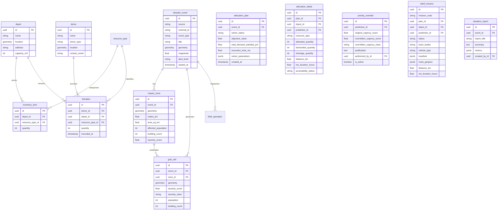
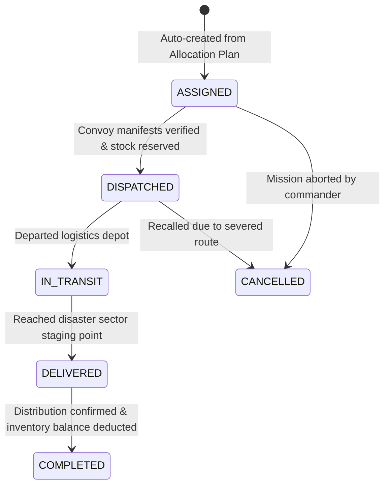

# System Architecture & Technical Specifications

> **Active Phase: Weeks 1–2** — Disaster Data Ingestion & Geospatial Impact Assessment.

---

## 1. High-Level Component Layout

The platform follows a layered, service-oriented architecture designed for scalability, clean separation of concerns, and reproducible deployment.

```text
┌────────────────────────────────────────────────────────────────────────┐
│                        React 18 + Vite Frontend                        │
│  ┌──────────────────┐ ┌──────────────────┐ ┌────────────────────────┐  │
│  │   Disaster Map   │ │   Events Feed    │ │  Inventory & Donors    │  │
│  │ (React-Leaflet)  │ │ (Filtering / UI) │ │  (Logistics & Stock)   │  │
│  └─────────┬────────┘ └────────┬─────────┘ └───────────┬────────────┘  │
└────────────┼───────────────────┼───────────────────────┼───────────────┘
             │                   │                       │
             ▼                   ▼                       ▼
┌────────────────────────────────────────────────────────────────────────┐
│                       FastAPI REST API (v1)                            │
│  /events  │  /ingestion  │  /zones  │  /grid-cells  │  /depots  │  ... │
└──────┬─────────────┬─────────────┬─────────────┬─────────────┬─────────┘
       │             │             │             │             │
       ▼             ▼             ▼             ▼             ▼
┌──────────────┐┌──────────────┐┌──────────────┐┌──────────────┐┌────────┐
│ Ingestion    ││ Impact       ││ Severity     ││ Inventory    ││ Donor  │
│ Connectors   ││ Engine       ││ Grid Service ││ Service      ││ Service│
└──────┬───────┘└──────┬───────┘└──────┬───────┘└──────┬───────┘└───┬────┘
       │               │               │               │            │
       ▼               ▼               ▼               ▼            ▼
┌────────────────────────────────────────────────────────────────────────┐
│                      Data Persistence & Storage                        │
│  PostgreSQL 16 + PostGIS 3.4 (with Spatial SQLite compatibility)       │
└────────────────────────────────────────────────────────────────────────┘
```

---

## 2. Ingestion Pipeline & Connectors (`R1`)

Ingestion is executed either automatically via `APScheduler` or on-demand via `POST /api/v1/ingestion/trigger`.

### Connector Architecture
All connectors inherit from `BaseConnector` (`app/connectors/base.py`):
```python
class BaseConnector(ABC):
    source_name: str
    async def fetch(self) -> list[RawDisasterEvent]: ...
```

- **GDACS (`app/connectors/gdacs.py`)**:
  - Connects to the Global Disaster Alert and Coordination System RSS feed (`https://www.gdacs.org/xml/rss.xml`).
  - Parses XML with `xml.etree.ElementTree` handling `geo:Point`, alert levels (Green, Orange, Red), and event types (EQ, TC, FL).
  - Normalizes geometry into GeoJSON Point objects with WGS84 coordinates.

- **USGS (`app/connectors/usgs.py`)**:
  - Connects to USGS Earthquake Hazards Program GeoJSON API (`all_day.geojson`).
  - Filters seismic events by magnitude threshold ($M \ge 3.0$).
  - Maps earthquake magnitude, focal depth in kilometers, and USGS event alert levels.

- **NDMA (`app/connectors/ndma.py`)**:
  - Connects to National Disaster Management Authority bulletins.
  - Implements a resilient HTTP parser with fallback to pre-bundled verified sample scenarios (`fixtures/ndma_sample.json`).

- **NASA FIRMS (`app/connectors/firms.py`)**:
  - Connects to NASA Fire Information for Resource Management System.
  - Uses `FIRMS_MAP_KEY` or synthetic MODIS/VIIRS thermal anomalies when API key is unpopulated.

### Upsert Logic
All events are committed idempotently using database upsert (`ON CONFLICT (source, external_id) DO UPDATE` in PostgreSQL, or select-and-update in SQLite). Each run logs an entry in `ingestion_run` with timestamps, records added, and execution status (`success`, `failed`, `partial`).

---

## 3. Geospatial Impact Assessment (`R2`)

When a disaster event is ingested or processed, the Geospatial Impact Engine (`app/services/impact.py`) generates its geometric footprint and extracts physical and demographic exposure metrics.

### Hazard Footprint Mathematical Formulations

1. **Earthquake Hazard Radius**:
   Empirical seismic attenuation models estimate the radius $R$ (in kilometers) of significant ground acceleration from magnitude $M$:
   $$R = 10^{(0.5 \cdot M - 1.2)} \quad \text{km}$$
   - Example ($M = 6.2$): $R = 10^{(0.5 \cdot 6.2 - 1.2)} = 10^{1.9} \approx 79.4\text{ km}$.
   - The circular polygon is generated via geodesic buffering around the epicenter $(lon, lat)$.

2. **Flood Hazard Footprint**:
   - For flood coordinates, a radial hydrological buffer of $25\text{ km}$ ($0.225^\circ$) is projected around reported inundation centroids.

3. **Tropical Cyclone Footprint**:
   - Cyclonic wind fields generate an extensive damage buffer of $100\text{ km}$ ($0.9^\circ$).

4. **Wildfire Hazard Perimeter**:
   - Active satellite thermal hotspots generate a thermal radiative buffer of $15\text{ km}$ ($0.135^\circ$).

### Zonal Population Statistics
- Population density is evaluated using `rasterio` zonal statistics against georeferenced raster datasets (WorldPop / synthetic GeoTIFF `population_sample.tif`).
- The hazard polygon geometry is transformed into raster coordinates using the affine transform matrix:
  $$\text{Population} = \sum_{p \in \text{Zone}} \text{PixelValue}(p)$$
- Output: `affected_population` integer count stored in `impact_zone`.

### Infrastructure Exposure via OpenStreetMap (Overpass API)
- The hazard footprint bounding box is converted into an Overpass QL query:
  ```overpass
  [out:json][timeout:15];
  (
    way["building"](south,west,north,east);
    relation["building"](south,west,north,east);
  );
  out count;
  ```
- **Caching & Fallback**: To ensure low latency and prevent Overpass API 429/406 rate-limits:
  1. An in-memory cache stores query results keyed by bounding box.
  2. If the external Overpass API is unreachable or times out, the engine computes a statistical building estimation based on land area and population density ($\approx 0.05 \text{ buildings per person}$), logging the fallback event cleanly.

---

## 4. Severity Grid Classification (`R4`)

The Grid Classification Service (`app/services/grid.py`) decomposes complex disaster footprints into regular geospatial tiles to support tactical operational dispatch.

### Grid Geometry Generation
- Hazard footprints are divided into regular $0.05^\circ \times 0.05^\circ$ ($\approx 5.5\text{ km} \times 5.5\text{ km}$) bounding boxes covering the envelope of the impact zone.
- Cells that intersect the hazard polygon geometry are saved as `grid_cell` entities.

### Composite Severity Formula
Each grid cell receives a normalized severity score ($S \in [0, 100]$):
$$S = w_h \cdot H + w_p \cdot P + w_b \cdot B$$

Where:
- $w_h = 0.40$ (Hazard Intensity Weight)
- $w_p = 0.35$ (Population Exposure Weight)
- $w_b = 0.25$ (Infrastructure Density Weight)
- $H$: Normalized hazard intensity based on event magnitude or alert level ($0 \dots 100$).
- $P$: Normalized cell population exposure: $\min\left(100, \frac{\text{cell\_pop}}{5000} \cdot 100\right)$.
- $B$: Normalized building count: $\min\left(100, \frac{\text{cell\_buildings}}{500} \cdot 100\right)$.

### Severity Classes
| Severity Score | Classification | Map Color Code | Tactical Priority |
|---|---|---|---|
| $0 \le S < 25$ | **Low** | `#22c55e` (Green) | Monitoring & Advisory |
| $25 \le S < 50$ | **Moderate** | `#eab308` (Yellow) | Assessment & Preparation |
| $50 \le S < 75$ | **High** | `#f97316` (Orange) | Active Resource Deployment |
| $75 \le S \le 100$ | **Critical** | `#ef4444` (Red) | Immediate Search & Rescue |

---

## 5. Resource Inventory & Business Logic (`R3` & `D1`)

### Strict Negative Stock Rejection
Stock adjustment is governed by atomic transactions in `app/services/inventory.py`:
$$\text{Stock}_{\text{new}} = \text{Stock}_{\text{current}} + \Delta$$

If $\text{Stock}_{\text{new}} < 0$:
- The transaction raises `InsufficientStockError("Insufficient stock: current=X, requested_change=Y")`.
- The database rolls back immediately; the API returns HTTP 400 Bad Request.

### Donor Replenishment (`D1`)
When a humanitarian aid consignment is recorded via `POST /api/v1/donations`:
1. The consignment record is persisted with donor ID, destination depot ID, resource type, and quantity.
2. The destination depot's stock for that resource is atomically incremented by the consignment quantity.
3. Both operations execute within a single atomic database transaction.

---

## 6. Database Schema Design (`R5`)



---

## 7. Google OR-Tools MILP Allocation Engine (Weeks 5–6)

The resource allocation engine (`app/services/allocation.py`) formulates a Mixed-Integer Linear Programming (MILP) model solved using the SCIP optimizer.

### Mathematical Formulation:

Let $D$ be the set of active depots, $Z$ be the set of impacted disaster sectors, and $R$ be the set of critical relief commodities:
$$R = \{\text{food\_packets}, \text{water}, \text{medical\_kits}, \text{shelter\_spaces}\}$$

Let $x_{d,z,r} \ge 0$ denote the integer quantity of resource $r$ allocated from depot $d$ to zone $z$.

#### Objective Function:
$$\max \sum_{z \in Z} \sum_{d \in D} \sum_{r \in R} \left( W_r \cdot U_z - \lambda \cdot \frac{\text{dist}(d,z)}{1000 \cdot A_z} \right) \cdot x_{d,z,r}$$
Where:
- $W_r$: Criticality weight of resource $r$ (Medical = 1.5, Water = 1.4, Food = 1.2, Shelter = 1.0)
- $U_z$: Zone urgency factor derived from ML model or elevated by commander priority override ($U_z = \text{urgency\_score} / 50.0$)
- $\lambda$: Haulage penalty coefficient (default $10^{-4}$)
- $\text{dist}(d,z)$: Road corridor distance in kilometers
- $A_z$: Road accessibility index ($A_z \in [0.1, 1.0]$)

#### Operational Constraints:
1. **Depot Inventory Capacity**:
   $$\sum_{z \in Z} x_{d,z,r} \le \text{Stock}_{d,r} \quad \forall d \in D, \forall r \in R$$
2. **Zone Demand Cap**:
   $$\sum_{d \in D} x_{d,z,r} \le \text{Demand}_{z,r} \quad \forall z \in Z, \forall r \in R$$
3. **Accessibility Threshold**:
   $$\text{If } A_z < 0.20 \text{ and enforce\_accessibility = True} \implies x_{d,z,r} = 0$$

---

## 8. NetworkX Logistics Routing Engine

The routing service (`app/services/routing.py`) maintains an embedded topological graph of 28 strategic National Highway trunk hubs across India:
- **Corridor Nodes**: Strategic logistic nodes (Delhi, Mumbai, Bengaluru, Chennai, Kolkata, Guwahati, Nagpur, Kochi, Bhopal, Ahmedabad, etc.).
- **Edge Weights**: Great-circle Haversine distances scaled by a $1.20$ highway curvature factor.
- **Duration Calculation**:
  $$\text{Effective Speed} = \begin{cases} 45.0 \cdot (0.5 + 0.5 \cdot A_z) \text{ km/h} & \text{if } A_z \ge 0.30 \\ 18.0 \text{ km/h} & \text{if Restricted/Severed} \end{cases}$$
- **GeoJSON Output**: Polyline coordinates formatted as standard GeoJSON LineStrings for interactive map rendering.

---

## 9. Relief Mission State Machine



