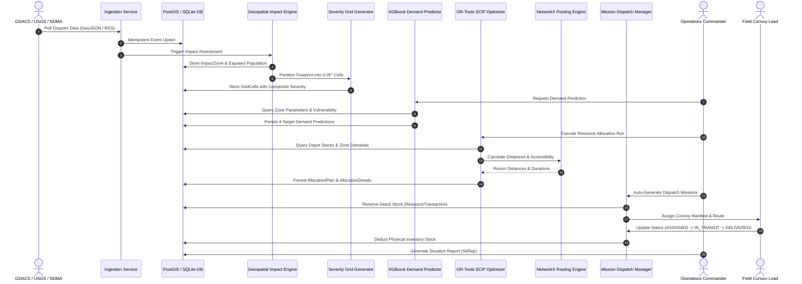
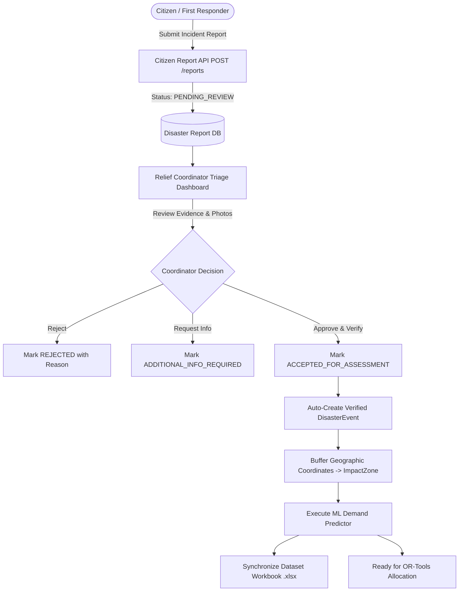
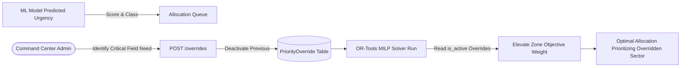

# Platform Data Flow Architecture

Complete data pipeline flows across ingestion, impact assessment, predictive intelligence, optimization, mission dispatch, and reporting.

---

## 1. End-to-End Operational Response Pipeline

---

## 2. Citizen Disaster Reporting & Triage Workflow

---

## 3. Commander Priority Override Flow

